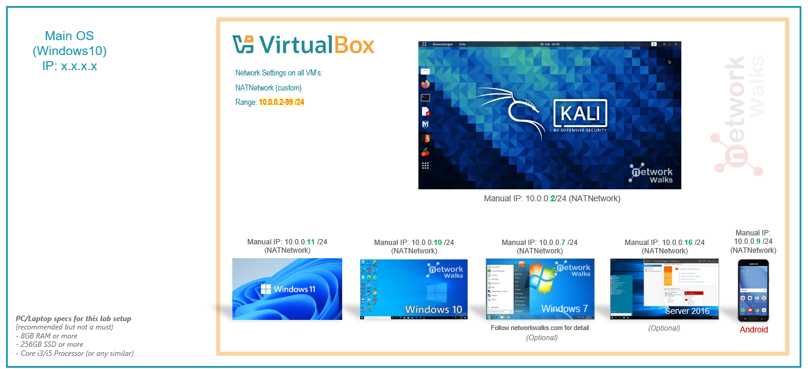
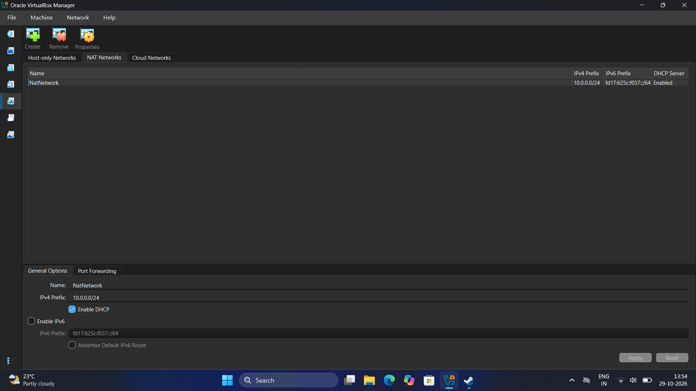
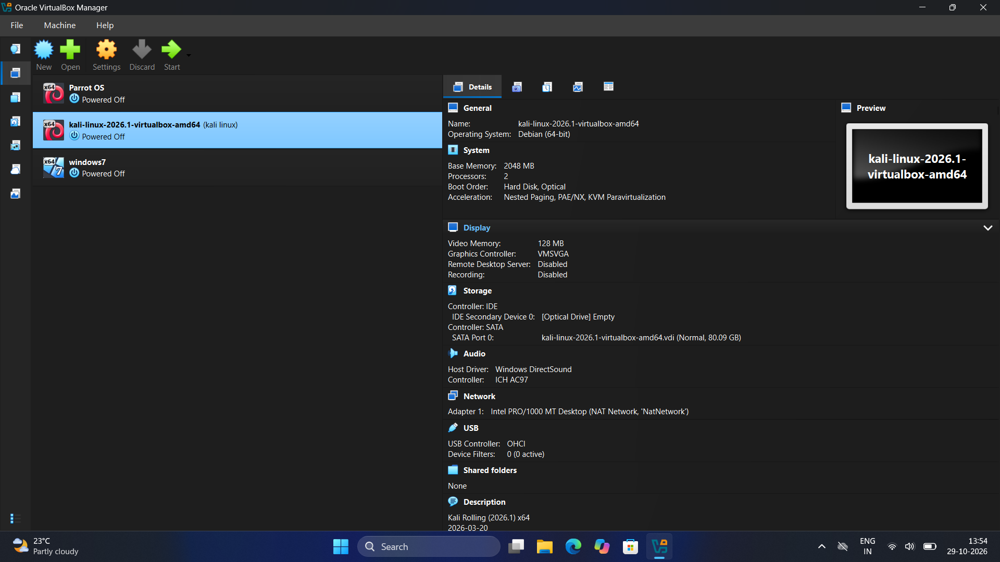
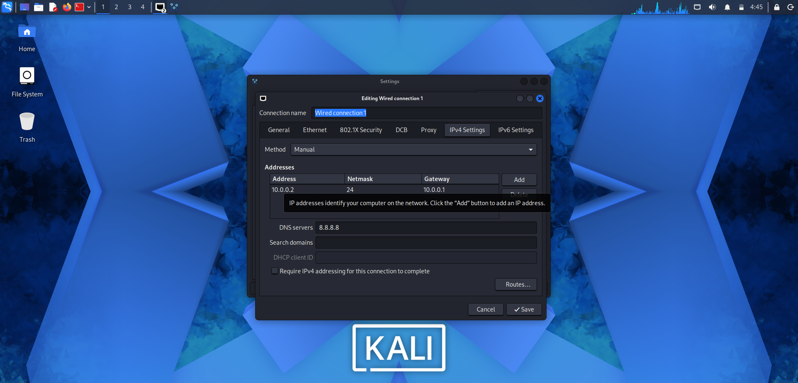
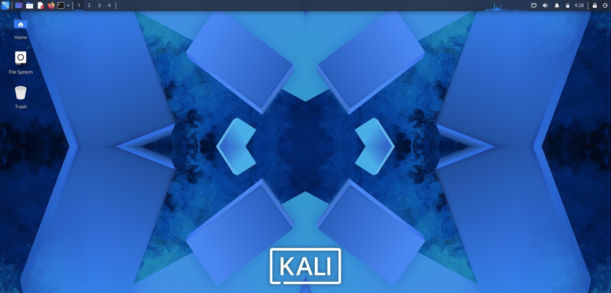

<div align="center">

# 🔐 Cybersecurity Lab Environment Setup

### Week 1 — NetworkWalks Cybersecurity Project

**Building an isolated virtual laboratory for ethical hacking and penetration testing**


</div>

---

## 📌 Project Overview

This project documents the setup and configuration of a virtual cybersecurity laboratory using Oracle VirtualBox and Kali Linux.

The objective is to establish a controlled environment for learning Linux networking, network reconnaissance, vulnerability assessment, packet analysis, and penetration-testing fundamentals.

A dedicated VirtualBox NAT Network has been configured to support communication between virtual machines while providing outbound network connectivity.

The environment can be extended with additional virtual machines for authorized security testing.

## 🎯 Objectives

- Install and configure Oracle VirtualBox.
- Import Kali Linux as a virtual machine.
- Create a dedicated NAT Network.
- Configure IPv4 networking in Kali Linux.
- Set a consistent private IP address for the Kali VM.
- Verify network connectivity and DNS resolution.
- Create a clean virtual-machine snapshot.
- Document the configuration and troubleshooting process.
- Prepare the environment for future cybersecurity exercises.

## 🛠️ Tools and Technologies

| Component | Configuration |
|---|---|
| Host operating system | Windows |
| Hypervisor | Oracle VirtualBox |
| Security distribution | Kali Linux |
| Virtual machine memory | 2048 MB |
| Virtual machine processors | 2 |
| Network mode | NAT Network |
| Virtual network name | NatNetwork |
| IPv4 network | `10.0.0.0/24` |
| Kali IPv4 address | `10.0.0.2` |
| Configured gateway | `10.0.0.1` |
| Configured DNS server | `8.8.8.8` |
| Network adapter | Intel PRO/1000 MT Desktop |

*Note: The screenshots show Kali Linux 2026.1 and VirtualBox 7.x. The exact VirtualBox version should be confirmed from the installed application before documenting a more specific version.*

---

## 🏗️ Lab Architecture

The laboratory uses Kali Linux as the initial security-testing machine connected to a dedicated NAT Network.



### Network Design

| Parameter | Value |
|---|---|
| Network name | `NatNetwork` |
| IPv4 prefix | `10.0.0.0/24` |
| Network address | `10.0.0.0` |
| Subnet mask | `255.255.255.0` |
| Kali IP address | `10.0.0.2` |
| Configured gateway | `10.0.0.1` |
| Configured DNS | `8.8.8.8` |
| DHCP | Enabled in VirtualBox |
| IPv6 | Disabled in NAT Network settings |

The configured Kali IP address is within the private IPv4 range used by the laboratory.

**Gateway note:** `10.0.0.1` is the gateway entered in the Kali network settings. The actual gateway and successful connectivity must be verified from Kali before treating them as confirmed results.

---

# ⚙️ Lab Setup Procedure

## Step 1: Install 7-Zip

7-Zip can be used to extract compressed virtual-machine archives when required.

Official download page: https://www.7-zip.org/download.html

## Step 2: Install Oracle VirtualBox

Oracle VirtualBox provides the virtualization environment used to run Kali Linux on the Windows host.

The VirtualBox Manager provides options for creating virtual machines, adjusting hardware resources, configuring network adapters, and managing snapshots.

Official download page: https://www.virtualbox.org/wiki/Downloads

## Step 3: Create the NAT Network

A dedicated NAT Network named `NatNetwork` was configured in VirtualBox.

Configuration:

```text
Network Name: NatNetwork
IPv4 Prefix:  10.0.0.0/24
DHCP:         Enabled
IPv6:         Disabled
```



A NAT Network allows virtual machines attached to the same network to communicate with one another while using network address translation for outbound connectivity.

This configuration provides a foundation for adding authorized target machines in future exercises.

## Step 4: Import Kali Linux

Kali Linux was imported into VirtualBox as a virtual machine.

The VM details visible in VirtualBox include:

```text
Operating System: Debian (64-bit)
Base Memory:      2048 MB
Processors:       2
Video Memory:     128 MB
```

The virtual machine's network adapter is configured as follows:

```text
Adapter 1
Attached to: NAT Network
Network:     NatNetwork
Adapter Type: Intel PRO/1000 MT Desktop
```



These settings provide the virtual hardware and network connection required to run Kali Linux.

## Step 5: Configure a Static IPv4 Address

The Kali Linux network connection is named `Wired connection 1`.

The IPv4 configuration shown in the network settings is:

```text
Method:      Manual
IP Address:  10.0.0.2
Netmask:     24
Gateway:     10.0.0.1
DNS Server:  8.8.8.8
```



The `/24` prefix corresponds to the subnet mask `255.255.255.0`.

A static IP address makes it easier to identify the Kali VM consistently during future laboratory exercises.

### Verify the Interface Configuration

Open a terminal in Kali Linux and run:

```bash
ip -br addr
```

Alternatively:

```bash
ip a
```

The network interface should show `10.0.0.2/24` if the configuration has been applied successfully.

The following command displays the routing table:

```bash
ip route
```

Check whether a default route is present and identify its gateway. If the configured gateway is correct, the default route should reference `10.0.0.1`.

## Step 6: Check Network Connectivity

Run the following commands individually.

### Check the default route

```bash
ip route
```

### Test the configured gateway

```bash
ping -c 4 10.0.0.1
```

### Test external IP connectivity

```bash
ping -c 4 8.8.8.8
```

### Test DNS resolution

```bash
getent hosts networkwalks.com
```

Alternatively, if `nslookup` is installed:

```bash
nslookup networkwalks.com
```

### Verify Nmap

```bash
nmap --version
```

These commands test different aspects of the configuration. A failed gateway ping does not always prove that the gateway is unavailable, because ICMP traffic may be filtered. External connectivity and DNS resolution should be evaluated separately.

**Verification status:** The screenshots provided confirm the configured IP address and VirtualBox network settings. Successful gateway connectivity, Internet access, and DNS resolution still need to be tested and documented using the actual command results.

## Step 7: Create a Clean Virtual-Machine Snapshot

After verifying that the initial configuration works, create a baseline snapshot in VirtualBox.

Suggested snapshot name:

```text
Clean Kali - Network Setup
```

A baseline snapshot provides a recovery point before subsequent experiments.

Snapshots should be created before potentially disruptive changes to the VM, network configuration, or security tools.

*Note: Snapshot creation and restoration should be recorded as completed only after these operations have actually been performed.*

---

# 🐞 Troubleshooting

## Problem 1: Internet Connectivity After Static IP Configuration

Manually configuring an IPv4 address can cause connectivity problems if the gateway, DNS server, or routing configuration is incorrect.

### Diagnostic commands

```bash
ip -br addr
ip route
cat /etc/resolv.conf
```

Check the following:

- The Kali interface has the expected IPv4 address.
- The subnet mask matches the NAT Network.
- The default gateway is correct for the actual VirtualBox network configuration.
- DNS settings are applied.
- The VM network adapter is attached to `NatNetwork`.

If the connection needs to be inspected using NetworkManager:

```bash
nmcli connection show
```

This command displays the available connection profiles.

The connection name shown in this environment is:

```text
Wired connection 1
```

Network connection names can differ between systems.

Do not change unrelated NetworkManager settings without first identifying the actual cause of the connectivity problem.

## Problem 2: VirtualBox Hardware Virtualization Error

A virtual machine may fail to start when hardware virtualization is disabled or when the host virtualization configuration is incompatible.

Possible troubleshooting steps:

1. Check whether Intel VT-x or AMD-V is enabled in BIOS/UEFI.
2. Save any required firmware changes.
3. Restart the computer.
4. Check the VirtualBox error message if the VM still fails to start.
5. Investigate any Windows virtualization or hypervisor conflicts indicated by the error.

The correct solution depends on the specific error displayed by VirtualBox.

## Problem 3: README Screenshots Not Displaying

GitHub renders Markdown image references relative to the repository file structure.

The screenshots in this repository are stored in the root directory rather than in a `screenshots` subdirectory.

Use these paths:

```markdown





```

Make sure the filenames match the repository exactly.

---

# 🔎 Verification Checklist

| Test | Command or action | Status |
|---|---|---|
| Kali IP address | `ip -br addr` | Configuration visible in screenshot |
| Subnet mask | `ip a` | `/24` visible in screenshot |
| Default gateway | `ip route` | Requires verification |
| Gateway connectivity | `ping -c 4 10.0.0.1` | Requires testing |
| External IP connectivity | `ping -c 4 8.8.8.8` | Requires testing |
| DNS resolution | `getent hosts networkwalks.com` | Requires testing |
| Nmap installation | `nmap --version` | Requires testing |
| Snapshot creation | VirtualBox Snapshots view | Requires verification |
| Snapshot restoration | Restore and verify configuration | Requires testing |

---

# 💡 What I Learned

### 1. Virtualization

I learned how VirtualBox allows multiple operating systems to run as virtual machines on a single host.

### 2. Virtual Networking

I learned how NAT Network configuration allows connected virtual machines to communicate within a shared virtual network.

### 3. IPv4 Addressing

I learned how IP addresses, subnet masks, gateways, and DNS servers are configured in Kali Linux.

### 4. Network Troubleshooting

I learned how to inspect network interfaces, routing information, and connectivity using Linux commands.

### 5. Snapshot Management

I learned why baseline snapshots are useful for restoring virtual machines to a known configuration before performing experiments.

### 6. Technical Documentation

I learned how to document configuration settings, troubleshooting procedures, verification commands, and screenshots in a GitHub repository.

---

# 🔐 Security and Ethical Use

This laboratory is intended for educational purposes and authorized cybersecurity testing.

- Test only systems that you own or have explicit permission to assess.
- Use isolated laboratory targets for penetration-testing exercises.
- Avoid exposing vulnerable practice machines to untrusted networks.
- Take snapshots before performing potentially disruptive experiments.
- Do not use the tools or techniques learned here to access systems without authorization.

---

# 🔗 Tools and Resources

- **7-Zip:** https://www.7-zip.org/download.html
- **Oracle VirtualBox:** https://www.virtualbox.org/wiki/Downloads
- **Kali Linux:** https://www.kali.org/get-kali/
- **GitHub Markdown Guide:** https://docs.github.com/en/get-started/writing-on-github

---

# 👤 Author

**Prashant Dubey**

GitHub: https://github.com/prashant041204

---

# 📚 Project Information

| Field | Details |
|---|---|
| Program | Cybersecurity at NetworkWalks |
| Week | Week 01 |
| Project | Cybersecurity and Penetration-Testing Lab Setup |
| Repository | `NETWORKWALKS-B082-WK1-PM1-CYBERSECURITY-LAB-SETUP` |
| Platform | GitHub |
| Primary tools | VirtualBox and Kali Linux |

---

<div align="center">

**Learning cybersecurity through practical, controlled laboratory exercises.**

</div>
