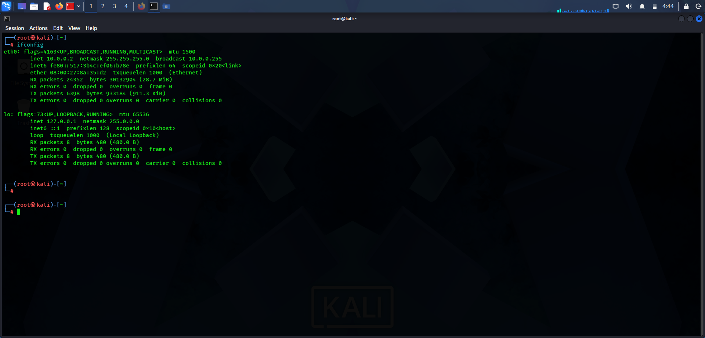

# NetworkWalks — Week 1: Cybersecurity Lab Setup


A hands-on cybersecurity lab setup completed as part of the NetworkWalks cybersecurity program. This project documents the configuration of Kali Linux in Oracle VirtualBox, including NAT Network configuration, static IPv4 addressing, and network verification.

The objective is to establish a controlled virtual lab environment for future networking, cybersecurity, and penetration-testing exercises.

---

## Table of Contents

- [Project Information](#project-information)
- [Lab Objectives](#lab-objectives)
- [Tools and Environment](#tools-and-environment)
- [Network Architecture](#network-architecture)
- [Lab Setup and Configuration](#lab-setup-and-configuration)
- [Static IPv4 Configuration](#static-ipv4-configuration)
- [Network Verification](#network-verification)
- [Screenshots](#screenshots)
- [Troubleshooting](#troubleshooting)
- [Security Considerations](#security-considerations)
- [Learning Outcomes](#learning-outcomes)
- [Conclusion](#conclusion)

---

## Project Information

| Field | Details |
|---|---|
| Program | Cybersecurity at NetworkWalks |
| Week | Week 01 |
| Project | Cybersecurity and Penetration-Testing Lab Setup |
| Virtualization Platform | Oracle VirtualBox |
| Operating System | Kali Linux |
| Network Mode | NAT Network |
| NAT Network Name | `NatNetwork` |
| IPv4 Network | `10.0.0.0/24` |
| Static IP Address | `10.0.0.2` |
| Default Gateway | `10.0.0.1` |
| DNS Server | `8.8.8.8` |

## Lab Objectives

The objectives of this exercise were to:

1. Set up Kali Linux in Oracle VirtualBox.
2. Create and configure a NAT Network.
3. Configure a static IPv4 address for Kali Linux.
4. Set the appropriate subnet mask, gateway, and DNS server.
5. Verify the network interface and assigned IP address.
6. Document the configuration and verification process.
7. Prepare a controlled environment for future cybersecurity labs.

## Tools and Environment

### Software

- Oracle VirtualBox
- Kali Linux
- NetworkManager
- GitHub for project documentation

### Virtual Machine Configuration

The Kali Linux virtual machine was configured with the following resources:

| Component | Configuration |
|---|---|
| Operating System | Kali Linux, 64-bit |
| Base Memory | 2048 MB |
| Virtual CPUs | 2 |
| Virtual Disk | Approximately 80 GB |
| Graphics Memory | 128 MB |
| Network Adapter | Intel PRO/1000 MT Desktop |
| Attached Network | `NatNetwork` |

These values reflect the VirtualBox configuration visible in the screenshots.

## Network Architecture

The lab uses a VirtualBox NAT Network with the following IPv4 configuration:

| Parameter | Value |
|---|---|
| Network Address | `10.0.0.0` |
| IPv4 Prefix | `/24` |
| Subnet Mask | `255.255.255.0` |
| Kali Linux IP | `10.0.0.2` |
| Configured Default Gateway | `10.0.0.1` |
| DNS Server | `8.8.8.8` |
| Broadcast Address | `10.0.0.255` |

The `/24` prefix provides 256 total IPv4 addresses, including the network and broadcast addresses.

**Important:** The configured gateway `10.0.0.1` must be verified against the actual VirtualBox NAT Network gateway. A configured gateway is not necessarily a reachable gateway until connectivity is tested.

## Lab Setup and Configuration

### Step 1: Prepare the VirtualBox Environment

Kali Linux was imported into Oracle VirtualBox and configured as a virtual machine.

The virtual machine uses a Debian 64-bit operating system profile and a virtual disk of approximately 80 GB.

**Screenshot:** `virtualbox-manager.png`

### Step 2: Create the NAT Network

A NAT Network named `NatNetwork` was created in VirtualBox.

The network configuration is:

- Network name: `NatNetwork`
- IPv4 prefix: `10.0.0.0/24`
- DHCP server: Enabled
- IPv6: Disabled

This configuration provides a private IPv4 network for virtual machines attached to the same NAT Network.

**Screenshot:** `nat-network-settings.png`

### Step 3: Attach Kali Linux to the NAT Network

The Kali Linux virtual machine was configured with the following network adapter settings:

- Adapter: Adapter 1
- Attached to: NAT Network
- Network: `NatNetwork`
- Adapter type: Intel PRO/1000 MT Desktop

**Screenshot:** `virtualbox-manager.png`

### Step 4: Configure the Static IPv4 Address

Inside Kali Linux, the network connection named `Wired connection 1` was configured using the Manual IPv4 method.

The configuration entered was:

```text
Method:       Manual
IP Address:   10.0.0.2
Netmask:      255.255.255.0
Gateway:      10.0.0.1
DNS Server:   8.8.8.8
```

The static IP address provides a consistent address for identifying the Kali Linux virtual machine during subsequent lab exercises.

**Screenshot:** `kali-ipv4-settings.png`

### Step 5: Apply the Network Configuration

The IPv4 configuration was saved through the Kali Linux network settings.

After applying the settings, the network interface was checked to confirm that the expected IPv4 address was assigned.

**Screenshot:** `kali-desktop.png`

### Step 6: Verify the Network Interface

The following command was executed in the Kali Linux terminal:

```bash
ifconfig
```

The output showed the following configuration for interface `eth0`:

```text
Interface:        eth0
IPv4 Address:     10.0.0.2
Netmask:          255.255.255.0
Broadcast:        10.0.0.255
Interface Status: UP
```

The output also showed zero received-packet errors and zero transmitted-packet errors at the time of the captured screenshot.

This confirms that the interface was up and had the expected IPv4 address. It does not, by itself, confirm that the default gateway or internet connectivity was working.

**Screenshot:** `kali-ifconfig.png`

## Static IPv4 Configuration

The static configuration can be reviewed using:

```bash
ip -4 addr show
```

To inspect the routing table:

```bash
ip route
```

To inspect the DNS configuration:

```bash
cat /etc/resolv.conf
```

The expected default route, if the gateway is correct and the route has been installed, is:

```text
default via 10.0.0.1
```

The actual output should be checked rather than assumed.

## Network Verification

The following commands can be used to test the configuration.

### 1. Verify the IP Address

```bash
ip -4 addr show eth0
```

Expected address:

```text
10.0.0.2/24
```

### 2. Verify the Default Route

```bash
ip route
```

Check whether the default route uses the intended gateway.

### 3. Test Gateway Connectivity

```bash
ping -c 4 10.0.0.1
```

Successful replies indicate that the gateway is reachable.

If this fails, verify the actual NAT Network gateway in VirtualBox before changing the configuration.

### 4. Test Internet Connectivity

After confirming the gateway:

```bash
ping -c 4 8.8.8.8
```

This tests connectivity to a public IP address without relying on DNS resolution.

### 5. Test DNS Resolution

```bash
getent hosts google.com
```

A returned IP address indicates that the hostname was resolved.

**Note:** These connectivity tests are recommended verification steps. They should only be reported as successful after the commands have actually been run and their results recorded.

## Screenshots

The following screenshots document the lab setup.

### 1. Lab Reference Image


The reference image illustrates the intended virtual lab arrangement and example IP addressing.

### 2. VirtualBox Manager


Shows the Kali Linux virtual machine and its configured network adapter.

### 3. NAT Network Configuration


Shows the configured `NatNetwork`, IPv4 prefix, and DHCP setting.

### 4. Kali Linux Desktop


Shows the Kali Linux virtual machine after startup.

### 5. Static IPv4 Settings


Shows the manually configured IPv4 address, subnet mask, gateway, and DNS server.

### 6. Network Interface Verification



Shows the output of `ifconfig`, including the assigned IPv4 address and interface status.

## Troubleshooting

### Gateway Is Unreachable

If `ping -c 4 10.0.0.1` fails:

1. Open VirtualBox's NAT Networks configuration.
2. Select `NatNetwork`.
3. Check its IPv4 prefix and NAT Network configuration.
4. Verify the gateway expected by that network.
5. Confirm that Kali Linux is attached to the correct NAT Network.
6. Check the routing table with `ip route`.

Do not assume that `10.0.0.1` is the correct gateway without verifying it.

### Internet Connectivity Is Unavailable

Check the following:

- The virtual machine's network adapter is enabled.
- The adapter is attached to `NatNetwork`.
- The NAT Network is configured correctly.
- The default route is present.
- The gateway is reachable.

### DNS Resolution Fails

Inspect the DNS configuration and test connectivity to a public IP address separately. This helps distinguish DNS problems from general connectivity problems.

## Security Considerations

- Perform future penetration-testing exercises only in authorized lab environments.
- Use isolated virtual networks when testing potentially disruptive tools.
- Avoid exposing vulnerable lab machines directly to public networks.
- Do not publish passwords, authentication tokens, or other sensitive information in the repository.
- Verify network isolation before running security experiments.

## Learning Outcomes

Through this exercise, the following concepts were practised:

- Virtual machine configuration in Oracle VirtualBox.
- NAT Network creation and configuration.
- IPv4 addressing and subnet masks.
- Static IP configuration in Kali Linux.
- Default gateway and DNS configuration.
- Network interface inspection using Linux commands.
- Technical documentation using Markdown and GitHub.

## Conclusion

The Kali Linux virtual machine was configured with a static IPv4 address of `10.0.0.2/24` and attached to the VirtualBox NAT Network named `NatNetwork`.

The captured terminal output confirms that the `eth0` interface was up and had the expected IPv4 configuration. Gateway reachability, internet connectivity, and DNS resolution should be verified separately before the lab is considered fully functional.

This setup provides a foundation for future networking and cybersecurity laboratory exercises.

---

## Author

**Prashant Dubey**

GitHub: [prashant041204](https://github.com/prashant041204)

**Program:** Cybersecurity at NetworkWalks  
**Project:** Week 01 — Cybersecurity and Penetration-Testing Lab Setup
